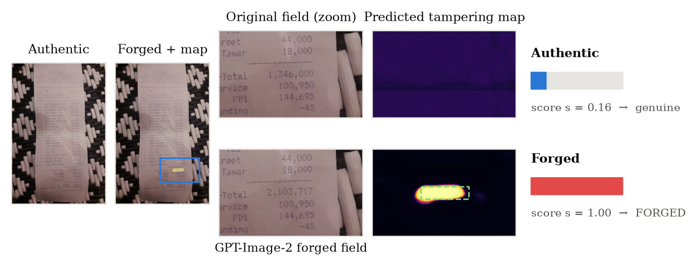
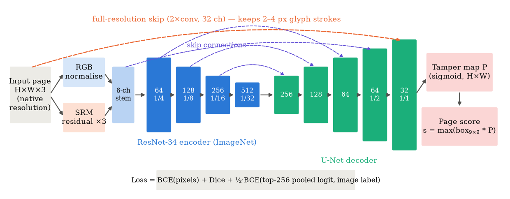

# FieldForensics: Localize to Detect AI-Forged Receipts and Forms

[](https://doi.org/10.5281/zenodo.24551852)


Code for the paper **"Localize to Detect: Full-Resolution Deep Forensics and Compression Cues for GPT-Image-2 Field Forgeries in Receipts and Forms"**
by Omkar Suryavanshi (D. Y. Patil International University, Pune). Paper: [`paper/FieldForensics_paper.pdf`](paper/FieldForensics_paper.pdf), DOI [10.5281/zenodo.24551852](https://doi.org/10.5281/zenodo.24551852).



Image generators such as GPT-Image-2 can rewrite one price or phone number on a receipt so well that humans and off-the-shelf detectors are at chance. The forged field covers only **0.76 %** of a page (median), so resizing the page destroys the evidence. **FieldForensics** analyses the page at native resolution, predicts a tampering heat-map, and scores the page by its peak.

## Results (AIForge-Doc v2, de-duplicated paired test set, 1,212 images)

| Method | AUC [95 % CI] | Accuracy | Paired 2AFC acc. | Pixel F1 |
|---|---|---|---|---|
| Human inspectors (published, zero-shot) | 0.501 | - | - | - |
| TruFor / DocTamper (published, zero-shot) | 0.599 / 0.585 | - | - | - |
| Raw-pixel logistic regression | 0.504 | 50.2 % | 52.8 % | - |
| Global ResNet-50 (resized page) | 0.501 | 50.1 % | 53.7 % | - |
| Forensic features (ELA, noise, blockiness) + GBDT | 0.817 [0.794, 0.838] | 71.8 % | 77.6 % | - |
| FieldForensics-R (degradation-augmented) | 0.839 [0.820, 0.857] | 70.5 % | 87.9 % | 0.486 |
| **FieldForensics** | **0.933 [0.919, 0.946]** | **84.6 %** | **92.9 %** | **0.667** |

The two published zero-shot rows were measured by the dataset authors on all 6,132 images, so they are reference points rather than a direct comparison. Under JPEG-75 re-compression the AUC falls to 0.608 (FieldForensics), 0.675 (FieldForensics-R) and 0.513 (forensic GBDT). The paper discusses this accuracy–robustness trade-off in detail. Per-image predictions for every experiment are in [`results/`](results/).

## Method in one picture



* ResNet-34 U-Net (ImageNet encoder) on **RGB + 3 fixed SRM noise residuals**, plus a full-resolution skip path for 2–4 px glyph strokes
* Trained on 384 px field-centred crops with **paired hard negatives**: the authentic crop at the same location as the forgery
* Loss: BCE + Dice on pixels + ½·BCE on a top-k pooled image logit
* Inference: tiled at native resolution; page score = max of the 9×9-smoothed map

## Repository layout

```
src/
  paths.py            project/data paths (override with FF_ROOT, AIFORGE_DIR)
  build_cache.py      verifies pairs, removes 31 duplicates, builds splits + fast .npy cache
  common.py           model, crop sampler (paired hard negatives), tiled inference
  train.py            training  (--aug 0 = FieldForensics, default = FieldForensics-R,
                                 --paired 0, --noise 0, --seg_w 0, --holdout <source>)
  evaluate.py         test-set evaluation under degradations (--conds none,jpeg75,social,...)
  baselines.py        pixel LR, forensic features + LR / GBDT
  gcnn.py             whole-page ResNet-50 baseline
  analyze.py          metrics, bootstrap CIs, paired significance tests, figures
  build_paper.py      renders paper/FieldForensics_paper.pdf and .tex from the results
scripts/run_experiments.sh   reproduces everything
splits/splits.json    exact de-duplicated train/val/test split used in the paper
results/              per-image predictions (CSV) and aggregated results.json
paper/                PDF, LaTeX source and figures
```

## Reproduce

1. **Data.** Download the *full package* of [AIForge-Doc v2](https://huggingface.co/datasets/Scam-AI/AIForge-Doc-v2), which includes the `authentic/` folders. Unzip it to `data/AIForge-Doc-v2.0/`, or set `AIFORGE_DIR`. The dataset is CC BY-NC-SA 4.0 and is **not** redistributed here.
2. **Environment.**
   ```bash
   pip install torch torchvision --index-url https://download.pytorch.org/whl/cu128
   pip install -r requirements.txt
   ```
3. **Run.**
   ```bash
   bash scripts/run_experiments.sh
   ```
   Or run single steps, for example:
   ```bash
   cd src
   python build_cache.py
   python train.py --name noaug --aug 0
   python evaluate.py --name noaug --conds none,jpeg75
   ```

A 6 GB GPU is enough: each model trains in about 20–35 minutes for 1,500 iterations, batch size 8 and 384 px crops. The cache needs about 19 GB of disk space.

## Citation

```bibtex
@misc{suryavanshi2026fieldforensics,
  title  = {Localize to Detect: Full-Resolution Deep Forensics and Compression Cues for GPT-Image-2 Field Forgeries in Receipts and Forms},
  author = {Suryavanshi, Omkar},
  year   = {2026},
  publisher = {Zenodo},
  doi    = {10.5281/zenodo.24551852}
}
```

## Acknowledgements

Thanks to the authors of AIForge-Doc, CORD, WildReceipt, SROIE and XFUND for releasing their data.
